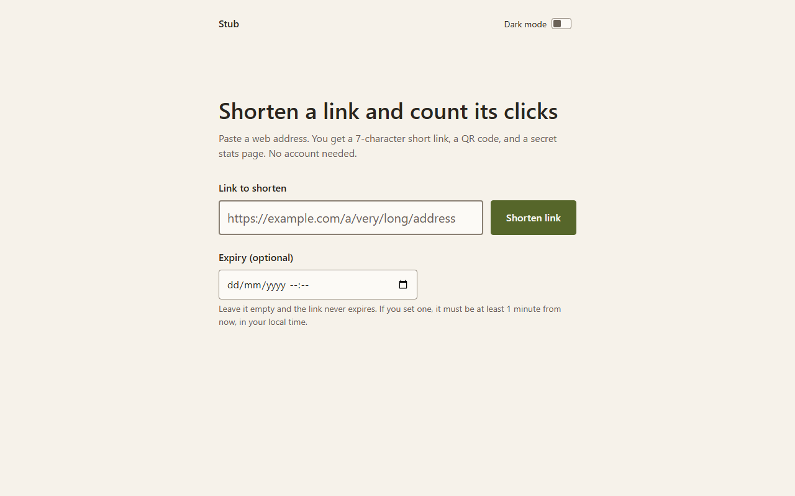
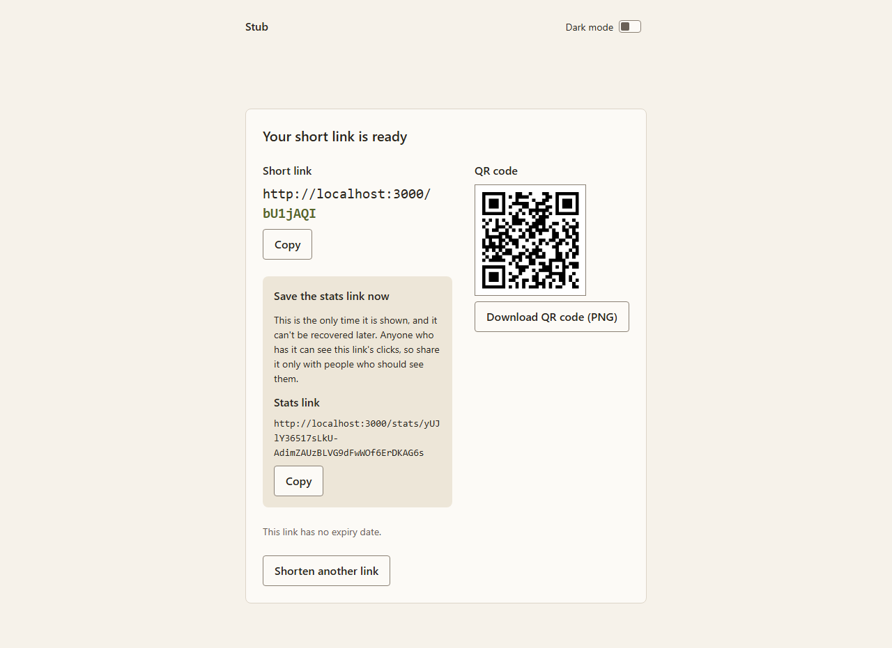
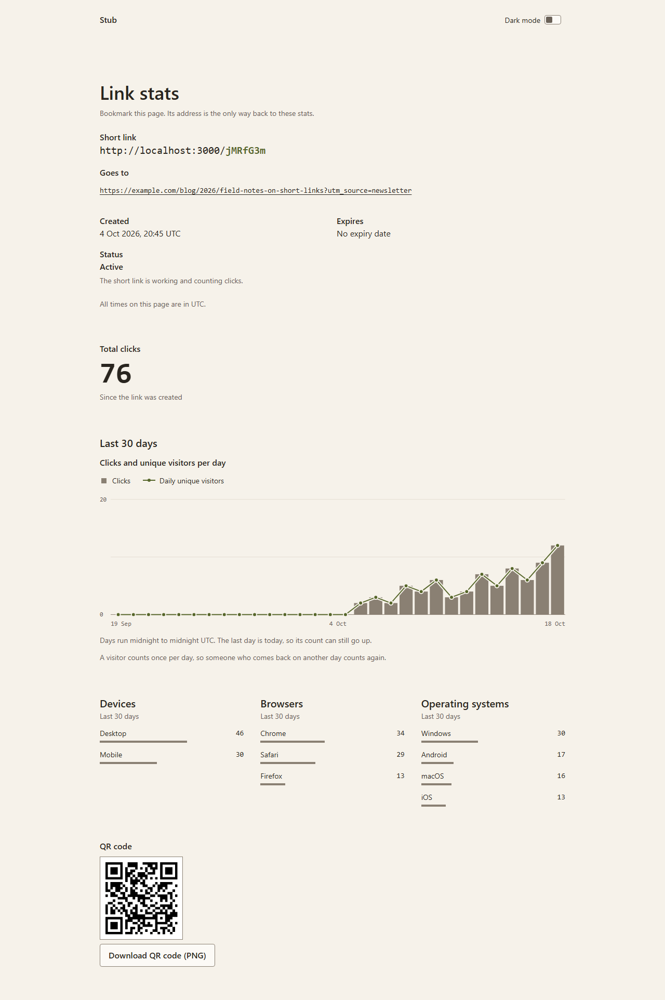
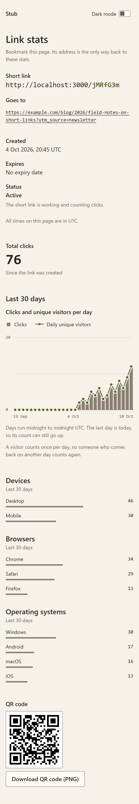

<div align="center">

# Stub

**Shorten a link. Count its clicks. No account.**

[](LICENSE)


[Quick start](#quick-start) · [How it works](#how-it-works) · [Privacy](#privacy) · [Documentation](docs/README.md)

<br>

<picture>
  <source media="(prefers-color-scheme: dark)" srcset="docs/images/home-dark.png">
  
</picture>

</div>

<br>

Stub turns a long web address into a 7-character short link. You also get a QR code and a private stats page that shows how often the link was used. Nobody signs up, and nobody logs in.

## What you get

- **A short link** for most `http` and `https` addresses. A few kinds are refused, such as hosts without a dot and links to Stub itself; the [validation rules](docs/api.md#validation) list them.
- **An optional expiry.** Set a date and time, and the link stops working then. Visitors see a clear notice instead of an error.
- **A QR code** for the short link, as a PNG you can download.
- **A private stats page.** Clicks and unique visitors per day for the last 30 days, with breakdowns by device, browser, and operating system. Dates are in UTC.
- **Light and dark themes.** Stub follows your device setting, and a switch in the header overrides it.

## How it works

Paste a link and pick an expiry if you want one. Stub answers with the short link, the QR code, and a stats link.

<div align="center">
<picture>
  <source media="(prefers-color-scheme: dark)" srcset="docs/images/result-dark.png">
  
</picture>
</div>

Save the stats link right away. Stub shows it once and cannot recover it, because it keeps only a hash of it. Share the short link, and open the stats link whenever you want to check on it.

<div align="center">
<picture>
  <source media="(prefers-color-scheme: dark)" srcset="docs/images/stats-dark.png">
  
</picture>
</div>

Anyone who has the stats link can read the stats, so share it only with people you trust.

<details>
<summary>The stats page on a phone</summary>
<br>
<div align="center">

</div>
</details>

## Privacy

Stub does not store visitors' IP addresses or raw browser strings. A visit is recorded as:

- a timestamp,
- a hash that changes every day and differs for each link,
- three labels: device type, browser, and operating system.

Stub sets no cookies and does not log referrers. Stats pages are marked `noindex` and are disallowed in `robots.txt`. The details are in [Architecture](docs/architecture.md#privacy-properties).

Creating a link stores one more thing: a keyed hash of the creator's IP address, used to limit each IP address to 20 new links per hour. It stays on file with the link. Stub does not check where a link leads.

## Quick start

You need Node.js 24 and Docker.

```bash
npm install
cp .env.example .env
```

Open `.env` and fill in the four values. The [getting started guide](docs/getting-started.md) lists them, including how to generate `HASH_SECRET`. Then:

```bash
docker compose up -d db
npm run db:migrate
npm run dev
```

The app runs at http://localhost:3000.

To run the whole app in Docker instead:

```bash
docker compose --profile app up --build
```

## Built with

Next.js 16 (App Router), React 19, TypeScript, PostgreSQL with Drizzle ORM, and CSS Modules with system fonts. Tests use Vitest and Playwright.

## Documentation

| Guide | What is in it |
|---|---|
| [Getting started](docs/getting-started.md) | Setup, database, migrations, Docker |
| [Configuration](docs/configuration.md) | Environment variables |
| [Architecture](docs/architecture.md) | Structure, data model, analytics, privacy |
| [Routes and API](docs/api.md) | Every route, status codes, error codes |
| [Testing](docs/testing.md) | Unit, integration, and end-to-end tests |
| [Operations](docs/operations.md) | Backups, link takedown, troubleshooting, known limitations |
| [npm scripts](docs/scripts.md) | What each script does |

The full index is in [docs/README.md](docs/README.md).

## License

Stub is released under the [MIT License](LICENSE).
